<picture>
  <source media="(prefers-color-scheme: dark) and (max-width: 560px)" srcset=".github/assets/hero-dark-sm.svg">
  <source media="(prefers-color-scheme: dark)" srcset=".github/assets/hero-dark.svg">
  <source media="(max-width: 560px)" srcset=".github/assets/hero-light-sm.svg">
  
</picture>

<!-- gallery:start -->
<table width="100%">
<tr>
<td width="25%" valign="top"><a href="https://github.com/ikerperez12/NexoIP-3D-Viewer">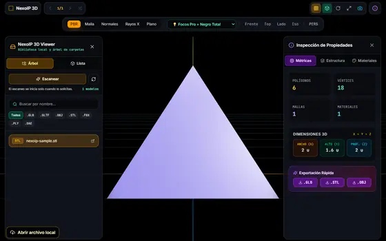</a> <b><a href="https://github.com/ikerperez12/NexoIP-3D-Viewer">NexoIP 3D Viewer</a></b> Offline-first desktop 3D viewer. Sandboxed renderer, private protocol, SBOM and checksums. <code>JavaScript</code> <code>MIT</code></td>
<td width="25%" valign="top"><a href="https://github.com/ikerperez12/IP-OS-LINUX">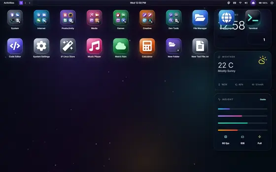</a> <b><a href="https://github.com/ikerperez12/IP-OS-LINUX">IP Linux</a></b> A desktop that runs in a tab: window manager, workspaces, IndexedDB filesystem. <code>12★</code> <code>TypeScript</code> <code>MIT</code> · <a href="https://ip-os-linux.vercel.app">live</a></td>
<td width="25%" valign="top"><a href="https://github.com/ikerperez12/UI-IP-Toolkit-v4.0">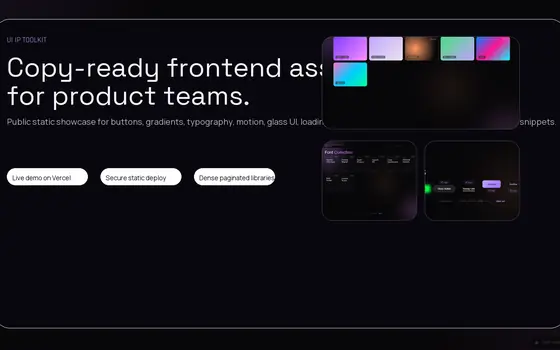</a> <b><a href="https://github.com/ikerperez12/UI-IP-Toolkit-v4.0">UI IP Toolkit</a></b> Copy-ready interface parts. axe-core gates serious regressions in CI. <code>9★</code> <code>HTML</code> <code>MIT</code> · <a href="https://ui-ip-toolkit.vercel.app/">live</a></td>
<td width="25%" valign="top"><a href="https://github.com/ikerperez12/e36">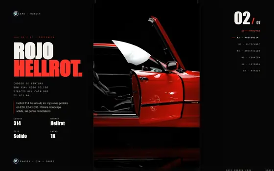</a> <b><a href="https://github.com/ikerperez12/e36">E36 Scroll Cine</a></b> Seven locked-scroll scenes, no framework. PWA with rendered accessibility tests. <code>4★</code> <code>HTML</code> <code>MIT</code> · <a href="https://e36.vercel.app">live</a></td>
</tr>
<tr>
<td width="25%" valign="top"><a href="https://github.com/ikerperez12/warpod">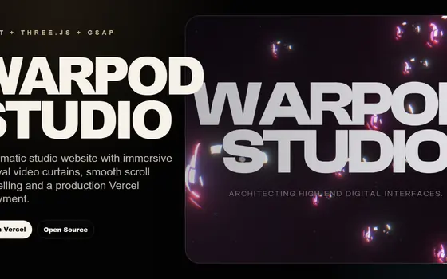</a> <b><a href="https://github.com/ikerperez12/warpod">Warpod Studio</a></b> Cinematic WebGL: React Three Fiber scene, GSAP choreography, smooth scroll. <code>4★</code> <code>JavaScript</code> <code>MIT</code> · <a href="https://warpod.vercel.app">live</a></td>
<td width="25%" valign="top"><a href="https://github.com/ikerperez12/EASY-LOCALHOST">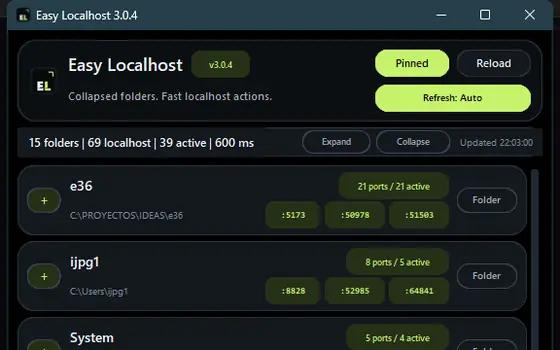</a> <b><a href="https://github.com/ikerperez12/EASY-LOCALHOST">Easy Localhost</a></b> Always-on-top panel for local dev servers. Ten releases, each with a SHA-256. <code>4★</code> <code>Python</code> <code>v3.0.4</code> <code>MIT</code></td>
<td width="25%" valign="top"><a href="https://github.com/ikerperez12/BLENDER-TOOL">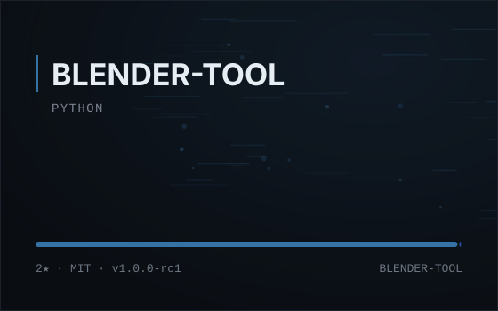</a> <b><a href="https://github.com/ikerperez12/BLENDER-TOOL">IP Blender Tool</a></b> Render queue for Blender. Scans .blend files for missing textures before queueing. <code>2★</code> <code>Python</code> <code>v1.0.0-rc1</code> <code>MIT</code></td>
<td width="25%" valign="top"><a href="https://github.com/ikerperez12/1.2-AuditoriaPQC">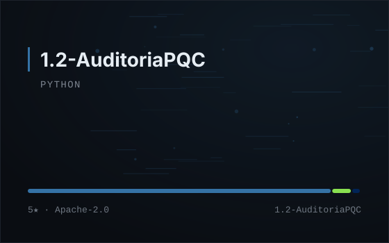</a> <b><a href="https://github.com/ikerperez12/1.2-AuditoriaPQC">QuantumGuard PQC lab</a></b> Post-quantum crypto lab driving real Open Quantum Safe containers. <code>5★</code> <code>Python</code> <code>Apache-2.0</code></td>
</tr>
<tr>
<td width="25%" valign="top"><a href="https://github.com/ikerperez12/SIGNAL-NEURALNETWORK">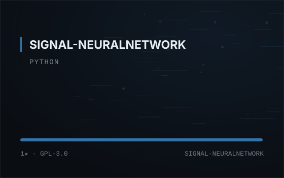</a> <b><a href="https://github.com/ikerperez12/SIGNAL-NEURALNETWORK">SIGNAL-NEURALNETWORK</a></b> Signal-processing neural network experiment. <code>1★</code> <code>Python</code> <code>GPL-3.0</code></td>
<td width="25%" valign="top"><a href="https://github.com/ikerperez12/GPT_CMD">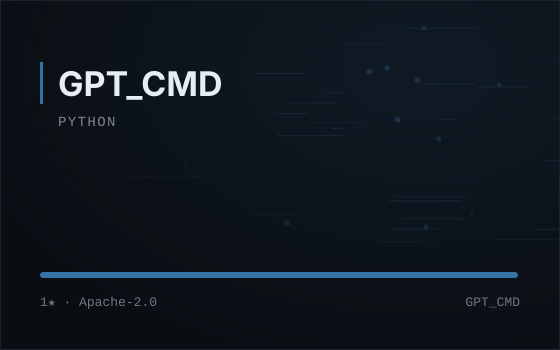</a> <b><a href="https://github.com/ikerperez12/GPT_CMD">GPT_CMD</a></b> Command-line ChatGPT automation with history, export and clipboard image send. <code>1★</code> <code>Python</code> <code>Apache-2.0</code></td>
<td width="25%" valign="top"> <b><a href="https://github.com/ikerperez12/1-click-world-showcase">One Click World</a></b> Daily geography game — public showcase and product gallery. <code>Showcase</code> <code>MIT</code></td>
<td width="25%" valign="top"> <b><a href="https://github.com/ikerperez12/KINIELA-showcase">KINIELA</a></b> Social football prediction game — public showcase and reference demo. <code>Showcase</code> <code>JavaScript</code></td>
</tr>
</table>
<!-- gallery:end -->

A Coruña, Galicia · [ikerperez12](https://github.com/ikerperez12)
